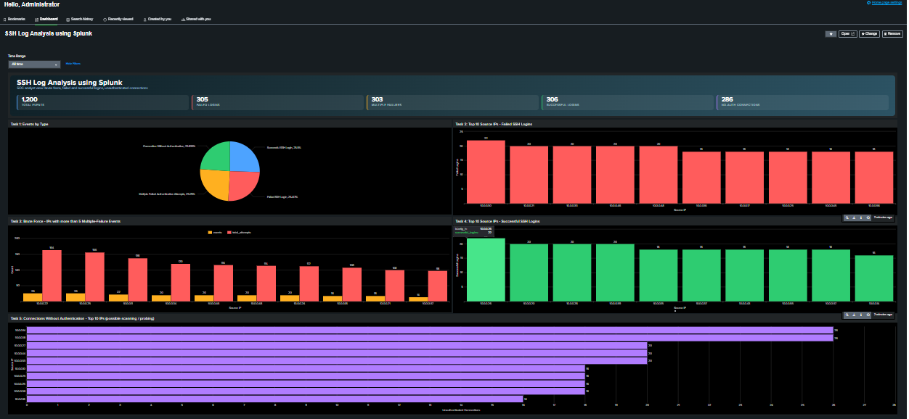
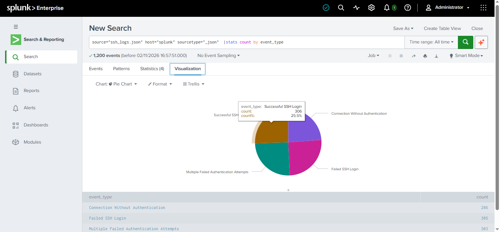
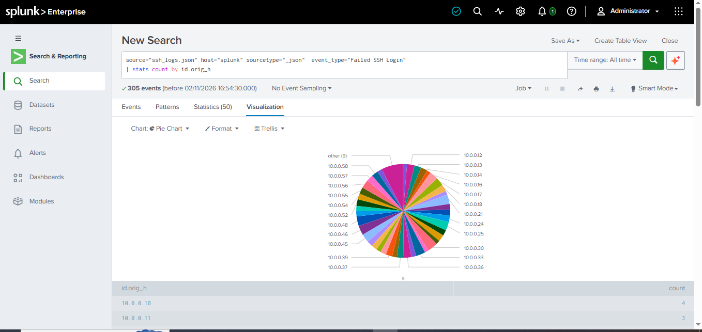
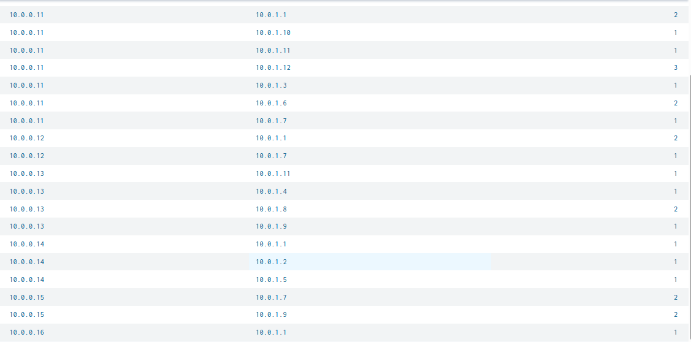
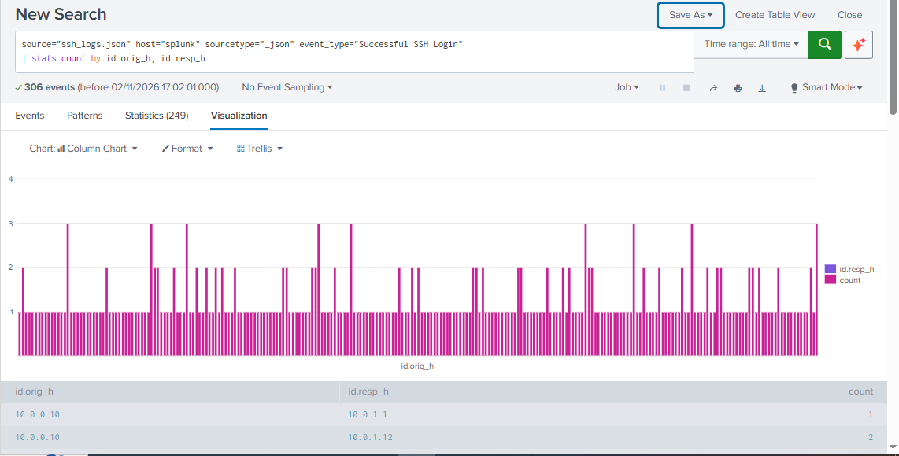
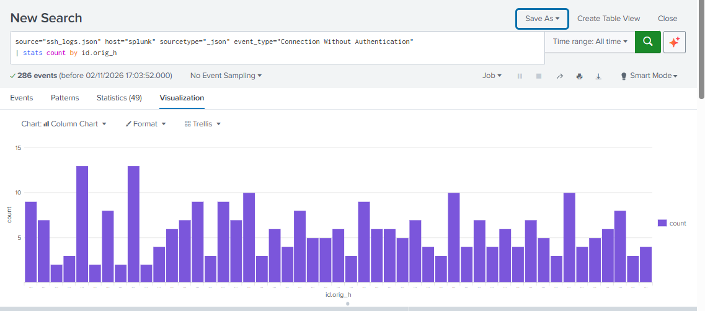

# SSH Log Analysis using Splunk

A hands-on SOC analyst project: analysing 1,200 SSH connection events in Splunk Enterprise to detect brute-force attempts, password spraying, suspicious successful logins and unauthenticated (scanning-style) connections.

> Built following the HAXCAMP lab [SSH Log Analysis using Splunk](https://app.haxcamp.com/projects/353bc3c9-c9e9-495e-8472-cc80fa5539f6/resources) (instructor: Rajneesh Gupta). The lab provides the dataset (`ssh_logs.json`) and the task outline. The queries, charts, custom dashboard and the findings below are my own work.

---

## Objective

Detect and investigate, from raw SSH logs:

- Successful logins (who connected, from where)
- Failed login attempts (possible brute force or password spraying)
- Multiple failed authentication attempts (strong brute-force indicator)
- Connections without authentication (possible scanning or SSH probing)

## Tools

- Splunk Enterprise (Search & Reporting, Classic Dashboards, Alerts)
- SPL (Search Processing Language)
- Dataset: `ssh_logs.json` (Zeek-style SSH connection records)

## Dataset

| Field | Meaning |
|---|---|
| `event_type` | Successful SSH Login / Failed SSH Login / Multiple Failed Authentication Attempts / Connection Without Authentication |
| `id.orig_h` | Source IP |
| `id.resp_h` | Destination host (`10.0.1.1` to `10.0.1.12`) |
| `auth_success` | true / false / null |
| `auth_attempts` | Number of authentication attempts in the session |

Upload settings: sourcetype `_json`, so Splunk extracts the fields automatically.

---

## Dashboard



The full dashboard source is in [`ssh_log_analysis_dashboard.xml`](ssh_log_analysis_dashboard.xml). To reuse it: Splunk > Dashboards > Create New Dashboard > **Classic Dashboards** > Source > paste > Save.

---

## Task 1: Ingest and parse logs

Validation search:

```spl
source="ssh_logs.json" | stats count by event_type
```

| event_type | count |
|---|---|
| Successful SSH Login | 306 |
| Failed SSH Login | 305 |
| Multiple Failed Authentication Attempts | 303 |
| Connection Without Authentication | 286 |
| **Total** | **1,200** |

The four event types are almost evenly split (about 25% each), and all fields were extracted correctly.



## Task 2: Analyse failed login attempts

```spl
source="ssh_logs.json" event_type="Failed SSH Login"
| stats count by id.orig_h
| sort - count
| head 10
```

305 failed logins came from 50 different source IPs. Top 10:

| Source IP | Failed logins |
|---|---|
| 10.0.0.30 | 11 |
| 10.0.0.21, 10.0.0.33, 10.0.0.46, 10.0.0.48 | 10 each |
| 10.0.0.16, 10.0.0.17, 10.0.0.25, 10.0.0.45, 10.0.0.56 | 9 each |

**Finding:** the top 10 IPs generated only 9 to 11 failures each. The gap is small and spread across many hosts, which looks like low-and-slow password spraying and not a single-source brute force. All sources are private (`10.0.0.x`) addresses, so in a real SOC this would point to compromised or misbehaving internal hosts and lateral movement risk.

> A pie chart with 50 slices is unreadable, so a column chart of the top 10 is used instead.



## Task 3: Detect brute force (multiple failed authentication attempts)

```spl
source="ssh_logs.json" event_type="Multiple Failed Authentication Attempts"
| stats count, sum(auth_attempts) as total_attempts by id.orig_h
| where count > 5
| sort - count
```

**Finding:** 28 source IPs triggered more than 5 "Multiple Failed Authentication Attempts" events. The top offender, `10.0.0.22`, accounted for 13 events and 82 total authentication attempts, followed by `10.0.0.25` and `10.0.0.11`. This confirms brute-force activity, and these IPs should be prioritised for investigation.

### Time-based detection

```spl
source="ssh_logs.json" (event_type="Failed SSH Login" OR event_type="Multiple Failed Authentication Attempts")
| bin _time span=10m
| stats count by _time, id.orig_h
| where count > 5
```

This returned 48 rows, all inside a single 10-minute window (24 Apr 2025, 15:50 IST), with `10.0.0.11` at 14 events. A tight burst like this is typical of automated attack tooling.

### Alert

Saved as a scheduled alert:

| Setting | Value |
|---|---|
| Title | SSH Brute Force Detected |
| Type | Scheduled (hourly) |
| Trigger condition | Number of results > 0 |
| Trigger | Once |
| Action | Add to Triggered Alerts |

Because the lab logs are from April 2025, the alert will not fire on "last 10 minutes". It is saved to demonstrate the detection logic and configuration.



## Task 4: Track successful logins

```spl
source="ssh_logs.json" event_type="Successful SSH Login"
| stats count by id.orig_h, id.resp_h
```

306 successful logins across 249 unique source and destination pairs.

### Compromise check (failed first, then successful)

```spl
source="ssh_logs.json" (event_type="Failed SSH Login" OR event_type="Successful SSH Login")
| stats count(eval(event_type="Failed SSH Login")) as failed,
        count(eval(event_type="Successful SSH Login")) as success by id.orig_h
| where failed > 0 AND success > 0
| sort - failed
```

IPs that fail and also succeed are candidates for a guessed or compromised credential and should be reviewed first.

### Logins that needed more than one attempt

```spl
source="ssh_logs.json" event_type="Successful SSH Login" auth_attempts>=2
| stats count by id.orig_h
| sort - count
```

A success after 2 to 3 attempts can be a mistyped password, or a password-guessing attempt that worked.



## Task 5: Suspicious connections without authentication

```spl
source="ssh_logs.json" event_type="Connection Without Authentication"
| stats count by id.orig_h
| sort - count
```

286 connections came from 49 source IPs. The busiest sources opened up to 13 connections without ever authenticating.

**Finding:** repeated sessions that connect and never authenticate are a classic sign of port scanning or SSH probing (banner grabbing, service discovery). These sources should be watched or rate-limited.

> Note on timechart: all 1,200 events in this dataset fall inside a window of a few milliseconds, so a normal `timechart` shows a single bar. Counting by source IP gives a more useful view for this data.



---

## Key takeaways

- Failed logins are spread across many internal IPs (password spraying pattern), while "multiple failed attempts" events concentrate on 28 IPs (brute force pattern).
- All activity is in one very short burst, which suggests scripted or automated activity.
- Every source and destination is in a private range, so the likely scenario is compromised internal hosts, not an external attacker.
- Detection logic built: top-N failed sources, threshold-based brute-force detection, a scheduled alert, a failed-then-successful compromise check and scan detection.

## Skills demonstrated

Splunk search and field extraction, SPL (`stats`, `eval`, `bin`, `where`, `sort`, `head`), threshold alerting, dashboard building (Classic XML), log analysis, brute force and password spraying detection, writing SOC-style findings.

## Repository structure

```
.
├── README.md
├── ssh_log_analysis_dashboard.xml
└── screenshots/
    ├── dashboard.png
    ├── task1-event-types.png
    ├── task2-failed-logins.png
    ├── task3-brute-force.png
    ├── task4-successful-logins.png
    └── task5-no-auth.png
```

## Credits

- Lab, task outline and dataset: [HAXCAMP, SSH Log Analysis using Splunk](https://app.haxcamp.com/projects/353bc3c9-c9e9-495e-8472-cc80fa5539f6/resources), instructor Rajneesh Gupta. The dataset belongs to HAXCAMP and is not included in this repository; download it from the lab page to reproduce the results.
- Splunk Enterprise is a product of Splunk Inc.

## Author

**Shivang**, entry-level cybersecurity professional focused on SOC analyst roles.
LinkedIn: [linkedin.com/in/cybershivang](https://www.linkedin.com/in/cybershivang)
